# FreeField

**Higgsfield-style viral video effects, open source. One photo in, one shareable clip out, on your own GPU, through
Comfy.**

Higgsfield's edge isn't a model. It's a library of presets: one-tap effects, each a small multi-model pipeline behind
a single upload button, and none of it open. FreeField makes the preset an **open file**: a ComfyUI workflow plus a
`preset.json` that exposes its inputs. A gallery app and a command line run the presets on open-weights models through
the **Comfy SDK**. FreeField checks its own output and re-renders when a hand wanders in from the edge or a face stops
looking like you. Adding a preset is one folder and no code, and a plain-words builder makes new ones.

> Built for Comfy's [Open Source Higgsfield challenge](https://comfy.org/open-source-higgsfield) (#OpenSourceHiggsfield).

## Gallery
**Runs on an 8 GB GPU** (Iris Reveal on the CPU). Each loop is a finished clip from [`examples/`](examples/README.md),
shrunk to a GIF.

| Earth Zoom Into My Clip | Product Freeze Ad | Natural Iris Reveal | Comic Bonk |
|---|---|---|---|
| 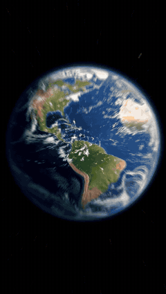 |  | 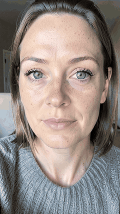 | 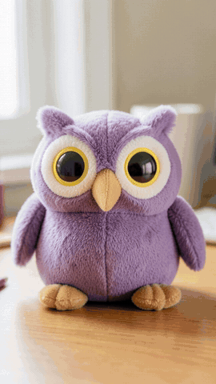 |

| Mascot Outfit Switch | Raven Poof | Raven Poof Intro |
|---|---|---|
| 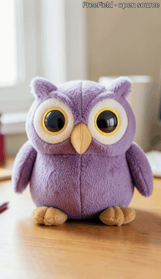 | 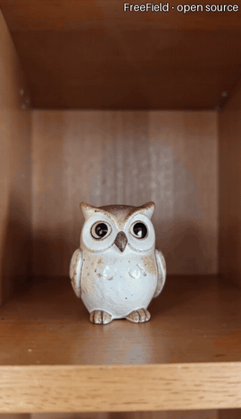 | 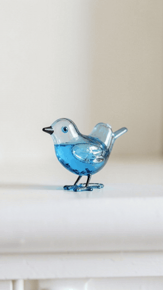 |

**Needs a 24 GB GPU** (Wan 2.2 I2V-A14B). Frames from the finished clips:

| Out of the Frame | Out of the Frame: your clip | Out of the Box |
|---|---|---|
| 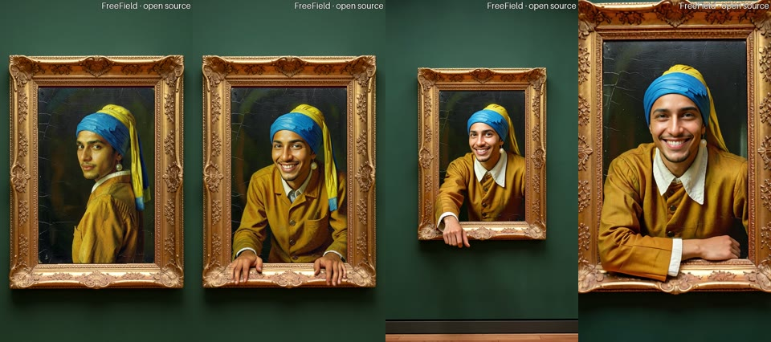 | 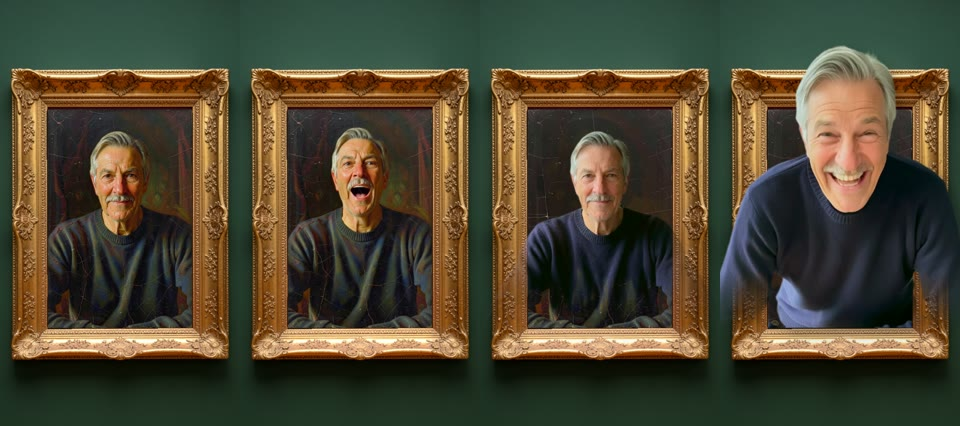 | 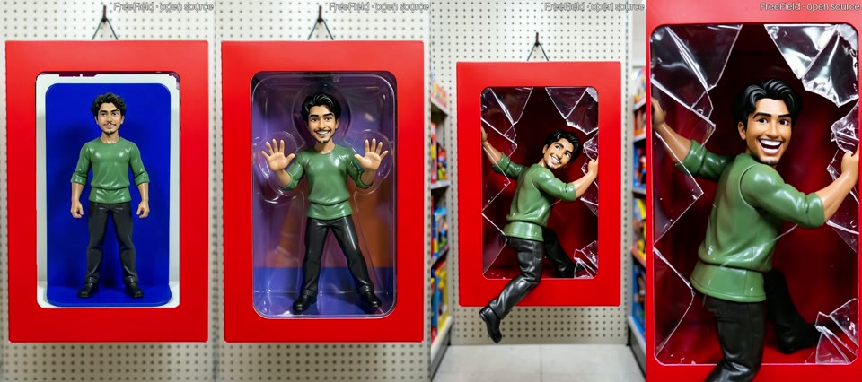 |
| **Out of the Photo** | **Toy Hug** | |
| 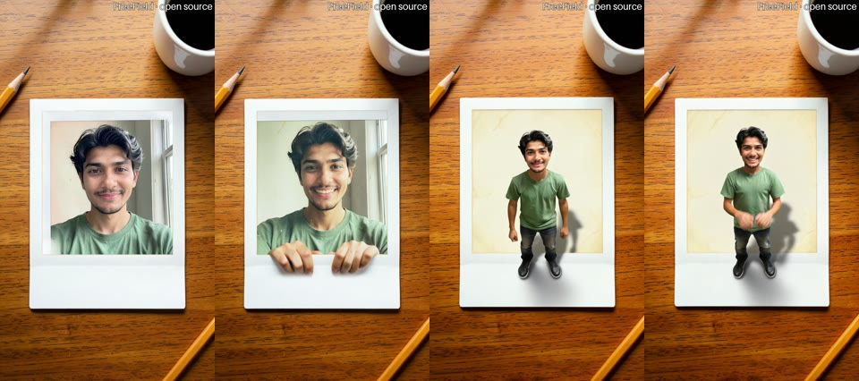 | 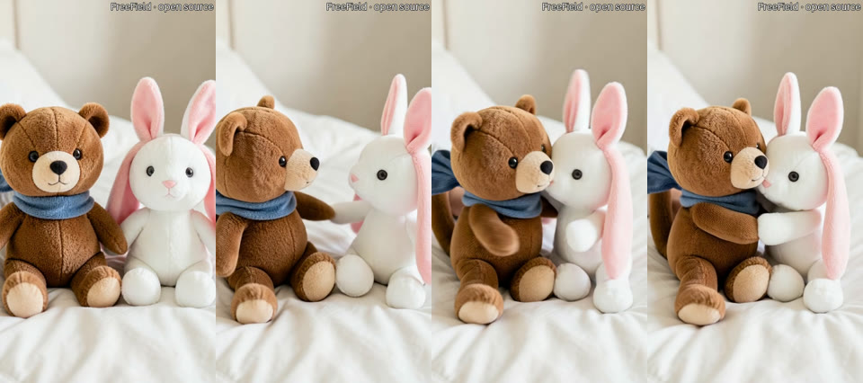 | |

Every person, toy, product and place in these clips is an AI stand-in. The inputs and the commands that made them are
in [`examples/`](examples/README.md).

## The effects
| Preset | What it does | GPU |
|---|---|---|
| `out-of-the-frame` | You, painted Vermeer-style into a gold frame; the painting comes alive, grabs the frame and leans out, real | 24 GB |
| `out-of-the-frame-real` | The same frame, but the person who comes out is your own selfie clip | 24 GB (`--still`: 8 GB) |
| `out-of-the-box`, `out-of-the-photo` | You break out of a toy blister pack, or climb out of an old instant photo | 24 GB |
| `out-of-the-frame-stills` | The Out of the Frame keyframes without the video | 8 GB |
| `earth-zoom` | From space through the clouds down to your place, then your own clip plays untouched | 8 GB |
| `product-freeze` | Your product frozen mid-splash, a parallax camera, your offer text, an end card | 8 GB |
| `iris-reveal` | A zoom into your clearer eye and back, from your photo's own pixels | none (CPU) |
| `comic-bonk` | A cartoon mallet bonks your mascot: squash, recoil, a BONK! burst and sound (toys and cartoons only) | 8 GB |
| `raven-poof`, `raven-intro` | Your object bursts into a flock of ravens; the intro version matches your photo's exposure and adds your title | 8 GB |
| `mascot-outfit-switch`, `paper-me`, `marble-statue` | Built from plain words: your mascot in an astronaut suit, you as a paper cutout, you as a marble statue | 8 GB |
| `toy-hug-studio` | Your two plush toys turn to each other and hug | 24 GB |
| `pearl-earring`, `monet-muse`, `the-scream` | You inside a public-domain painting, brought to life, with the original underneath | 8 GB |
| `action-figure`, `magazine-cover`, `superstar`, `penguin-ride`, `coastal-ride` | Toy box, magazine cover, jumbotron and ride presets | 8 GB |

`python -m freefield list` prints them all. Each one is a folder in `freefield/presets/`.

## Quickstart
You need Linux, an NVIDIA GPU with 8 GB or more, 16 GB of RAM, about 25 GB of disk, and `git`, `ffmpeg`, `curl` and
[`uv`](https://docs.astral.sh/uv/). Node.js 22+ and Chrome are only needed to lay out UI workflows.
```bash
git clone https://github.com/droppedmyza/freefield.git && cd freefield
scripts/setup.sh            # ComfyUI, PyTorch (cu130), ComfyUI-GGUF, comfy-sdk, comfy-api-proxy, FreeField, ~21 GB of open weights
scripts/start_comfy.sh      # ComfyUI on :8188 and the Comfy API v2 proxy on :8189
.runtime/venv/bin/python -m freefield serve        # the gallery app on http://127.0.0.1:8190
```
From the command line:
```bash
.runtime/venv/bin/python -m freefield run pearl-earring --photo me.jpg
.runtime/venv/bin/python -m freefield run earth-zoom --clip walk.mp4 --caption "Lisbon"
.runtime/venv/bin/python -m freefield run iris-reveal --photo selfie.jpg      # CPU only, no ComfyUI needed
```
A run prints one JSON report: the files, the warnings and the checks. Bad input is refused with exit code 2 before
any GPU work. On an RTX 2070 SUPER (8 GB) a clip takes about 2 minutes, model loading included.
`scripts/stop_comfy.sh` stops ComfyUI and the proxy.

**The 24 GB presets** (Wan 2.2 I2V-A14B): on a 24 GB GPU machine, for example a rented RTX 4090, run
`scripts/studio_setup.sh` after cloning. It installs the same stack plus the 14B weights. A clip takes about 4 minutes
on a 4090.

**Comfy Cloud instead of your GPU:** `export COMFY_API_KEY=...` and leave `COMFY_BASE_URL` unset. The same code runs
there. This route has not been tested yet.

## How it works
```
 browser gallery ──► freefield app (aiohttp) ──► Comfy SDK (comfy-sdk, Comfy API v2)
 python -m freefield ─┘                             │
                     COMFY_BASE_URL=http://127.0.0.1:8189 (default)    unset + COMFY_API_KEY
                                   │                                          │
                          comfy-api-proxy ──► your ComfyUI          Comfy Cloud / Comfy API deployment
```
- **Presets** are a ComfyUI graph and a manifest: which node inputs you fill in, which the author fixes, which outputs
  are the result. See [docs/PRESET_FORMAT.md](docs/PRESET_FORMAT.md).
- **Composited effects** (Earth Zoom, Product Freeze, Iris Reveal, Comic Bonk, Raven Intro, Out of the Frame with your
  clip) run their graphs, then finish the video on the CPU: camera moves, titles, sound, your own footage.
- **Checks** run on every result and trigger re-renders: likeness, "does it show what you asked for", hands or tools
  at the frame edge, person-animal hybrids. Every threshold and what it was calibrated on is in
  [docs/CHECKS.md](docs/CHECKS.md).
- [docs/HOW-IT-WORKS.md](docs/HOW-IT-WORKS.md) maps the code. [docs/GRAPHS.md](docs/GRAPHS.md) explains each graph.

## The ComfyUI workflows
[`workflows/`](workflows/README.md) holds the exact graph of every gallery effect, as a UI workflow to drag onto
ComfyUI and as the API workflow FreeField submits. Each opens with an **About this workflow** note, then numbered
groups with a plain-words title on every node. A load proof shows that all 11 open in a fresh ComfyUI with no missing
nodes.

## Make your own effect
- **In plain words:** `python -m freefield build "make me a paper cutout, then I slowly turn my head and smile, with a
  reveal" --render --photo me.jpg`. A small, documented grammar (no LLM) turns the sentence into a validated ComfyUI
  graph and a draft preset. The draft renders a checked preview and is published only after you approve it
  (`python -m freefield publish <id> --approve`). The app's "Make an effect" sheet does the same.
- **A breakout from a scene:** `python -m freefield factory specs/out-of-the-photo.json --photo me.jpg`. Write a scene
  prompt with a flat magenta opening and the factory derives the plate, masks, camera and gate. It publishes the
  preset only if its gated preview passes.
- **By hand:** a folder with `preset.json` pointing at a shared graph or your own ComfyUI "Export (API)" workflow
  ([docs/PRESET_FORMAT.md](docs/PRESET_FORMAT.md)).

## Tests
`.runtime/venv/bin/python -m pytest` runs about 360 tests in about 5 minutes on the CPU. No GPU or running ComfyUI is
needed. The likeness and edge checks run on real past failures in `tests/fixtures/`.

## Models and licenses
| Model / asset | Use | License |
|---|---|---|
| [FLUX.2 [klein] 4B](https://huggingface.co/black-forest-labs/FLUX.2-klein-4b-fp8) (Black Forest Labs) | identity keyframes | Apache-2.0 |
| Qwen3-4B text encoder ([Comfy-Org repack](https://huggingface.co/Comfy-Org/z_image_turbo)) | klein text encoder | Apache-2.0 |
| [Wan 2.2 TI2V-5B Turbo GGUF](https://huggingface.co/hum-ma/Wan2.2-TI2V-5B-Turbo-GGUF) | image-to-video | Apache-2.0 |
| [umt5-xxl GGUF](https://huggingface.co/city96/umt5-xxl-encoder-gguf) | Wan text encoder | Apache-2.0 |
| [Wan 2.2 I2V-A14B](https://huggingface.co/Wan-AI/Wan2.2-I2V-A14B) ([Comfy-Org fp8 repack](https://huggingface.co/Comfy-Org/Wan_2.2_ComfyUI_Repackaged)) | studio profile: Out of the Frame shots | Apache-2.0 |
| [lightx2v Wan 2.2 I2V 4-step LoRAs](https://huggingface.co/lightx2v/Wan2.2-Lightning) (Comfy-Org repack) | studio profile: 4-step sampling | Apache-2.0 |
| umt5-xxl fp8, Wan 2.1 VAE (Comfy-Org repacks) | studio profile: text encoder, VAE | Apache-2.0 |
| [ComfyUI](https://github.com/comfyanonymous/ComfyUI), [ComfyUI-GGUF](https://github.com/city96/ComfyUI-GGUF) | runtime | GPL-3.0 / Apache-2.0 |
| [comfy-sdk](https://github.com/Comfy-Org/comfy-python-sdk), [comfy-api-proxy](https://github.com/Comfy-Org/comfy-api-proxy) | Comfy Developer Platform | MIT / MIT |
| Vermeer, *Girl with a Pearl Earring* (1665) | museum preset asset | public domain ([Wikimedia Commons](https://commons.wikimedia.org/wiki/File:1665_Girl_with_a_Pearl_Earring.jpg)) |
| Monet, *Woman with a Parasol* (1875) | museum preset asset (cropped) | CC0 ([National Gallery of Art via Wikimedia Commons](https://commons.wikimedia.org/wiki/File:Claude_Monet,_Woman_with_a_Parasol_-_Madame_Monet_and_Her_Son,_1875,_NGA_61379.jpg)) |
| Munch, *The Scream* (1893) | museum preset asset | public domain ([Wikimedia Commons](https://commons.wikimedia.org/wiki/File:Edvard_Munch,_1893,_The_Scream,_oil,_tempera_and_pastel_on_cardboard,_91_x_73_cm,_National_Gallery_of_Norway.jpg)) |
| [Luckiest Guy](https://fonts.google.com/specimen/Luckiest+Guy) font (Astigmatic), `freefield/fonts/` | header-card titles | Apache-2.0 |
| [Playfair Display](https://fonts.google.com/specimen/Playfair+Display) font (Claus Eggers Sørensen), `freefield/fonts/` | magazine masthead (`make_header.py --style magazine`) | OFL-1.1 |
| [BiRefNet](https://huggingface.co/Comfy-Org/BiRefNet) (Comfy-Org repack) | cut-outs (Comic Bonk, Out of the Frame: your clip) | MIT |
| [Depth Anything V2 Small](https://huggingface.co/depth-anything/Depth-Anything-V2-Small-hf) | Product Freeze parallax camera | Apache-2.0 |
| [OWLv2 base](https://huggingface.co/google/owlv2-base-patch16-ensemble) | edge check: hands or tools entering a preview | Apache-2.0 |
| Checks: [AuraFace](https://huggingface.co/fal/AuraFace-v1), [YuNet](https://github.com/opencv/opencv_zoo), [OpenCLIP ViT-B-32](https://huggingface.co/laion/CLIP-ViT-B-32-laion2B-s34B-b79K) | likeness and content checks | Apache-2.0 / MIT / MIT |

No partner nodes or paid APIs are used: open weights only. FreeField's own code is MIT (see [LICENSE](LICENSE)).

## Responsible use
Use photos of yourself, or of people who said yes. Comic Bonk refuses real people and pets. The examples and test
subjects in this repo are synthetic people generated with FLUX.2 [klein], and the paintings are public domain or CC0.
Every clip carries a small "FreeField · open source" watermark.

## Known limits
- The four breakout effects and Toy Hug need a 24 GB GPU; the rest run on 8 GB, and Iris Reveal on the CPU.
- Out of the Frame tends to end the same way for every seed. Out of the Box's backing card can morph in the first
  second.
- The edge check catches most stray hands (9 of 10 labelled bad clips, 0 of 37 clean ones flagged) but misses some
  motion-blurred ones. A clip that fails its checks after the re-renders ships with an "Unverified" warning.
- Earth Zoom has not been tried on real phone footage yet, and Product Freeze not on real product photos.
